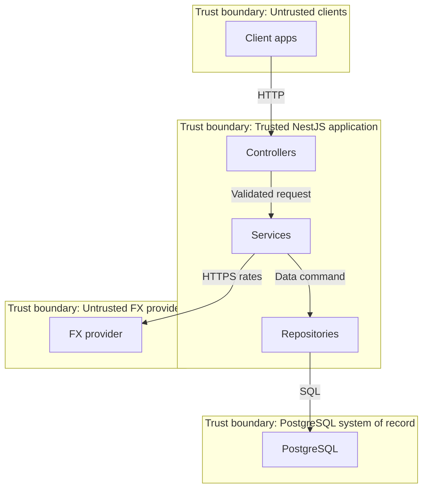
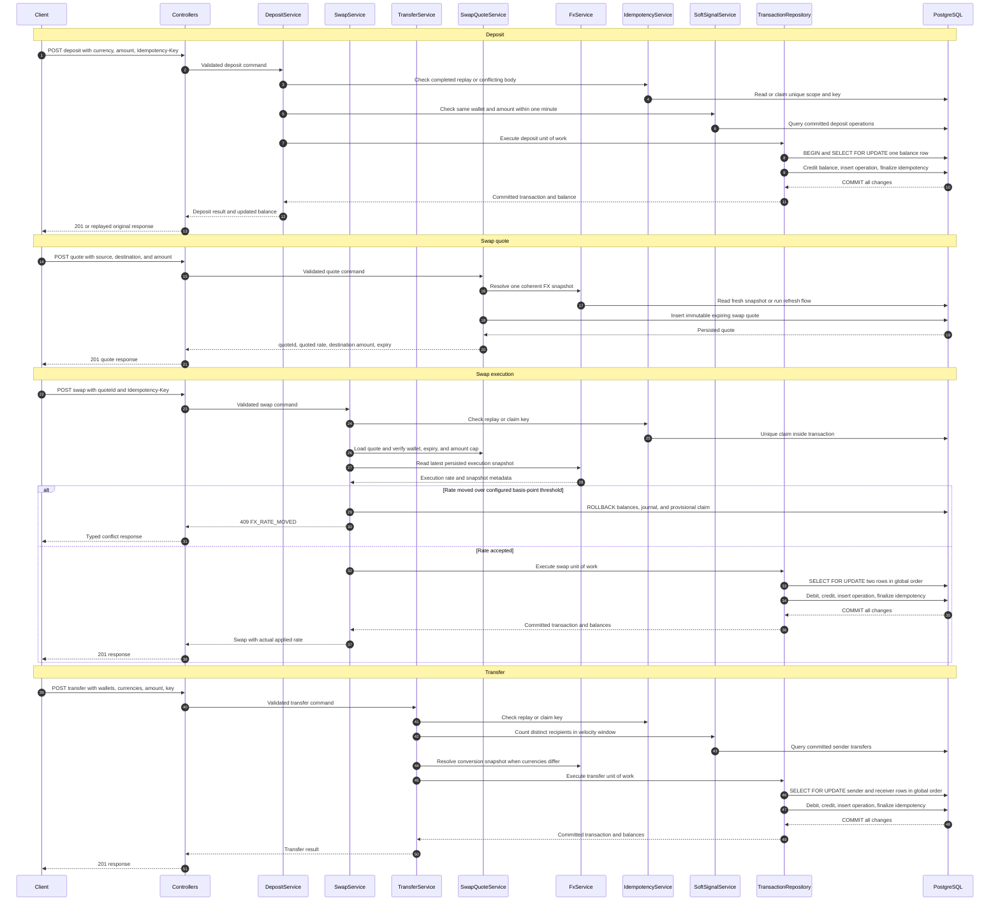
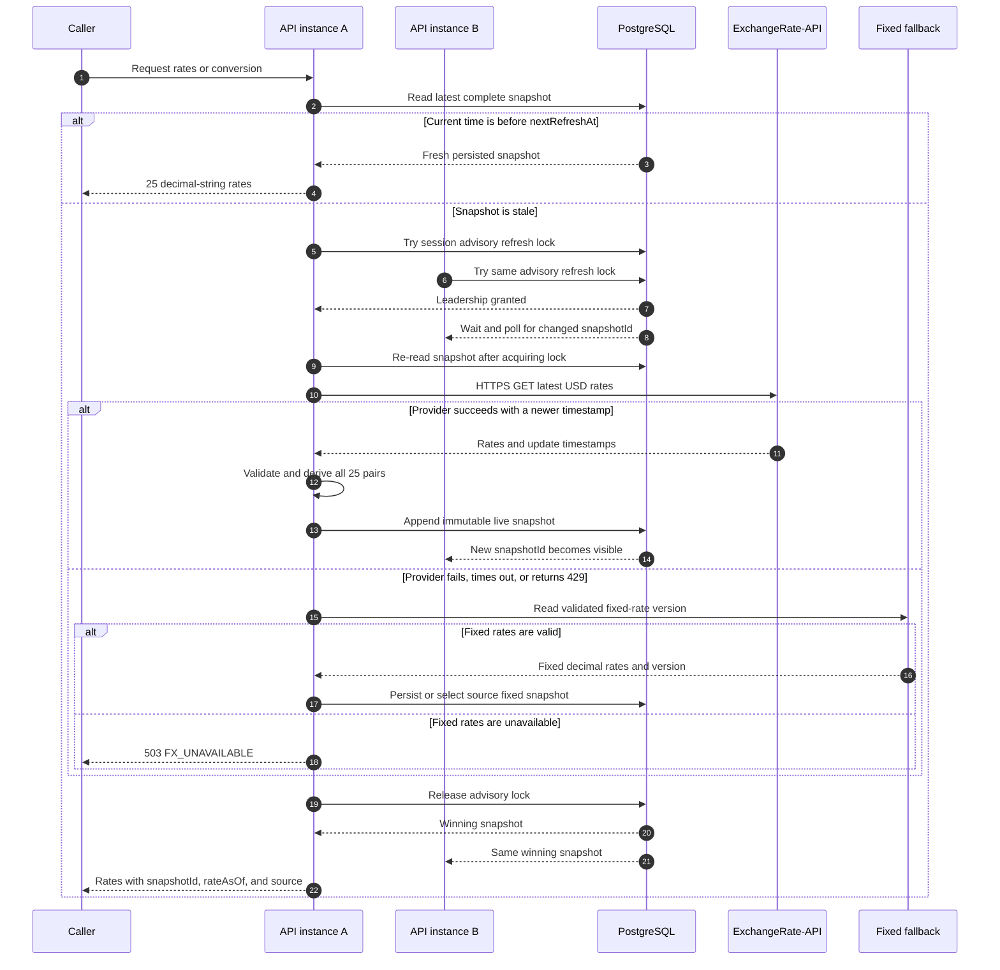
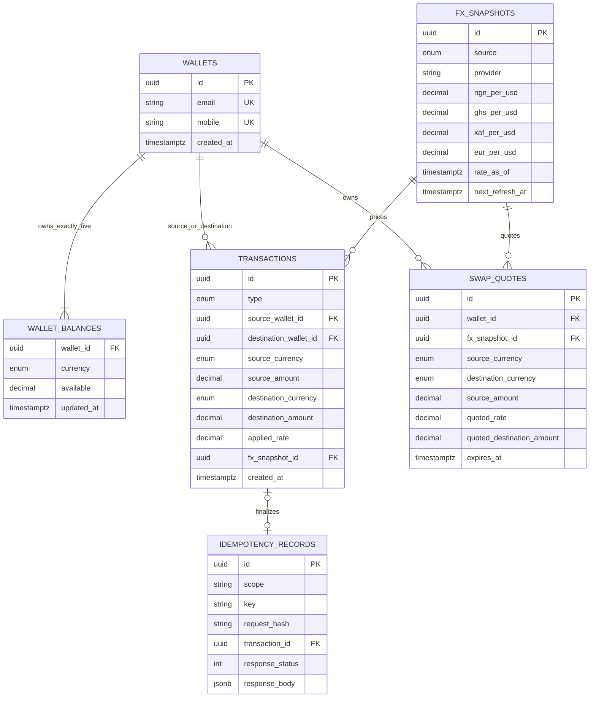
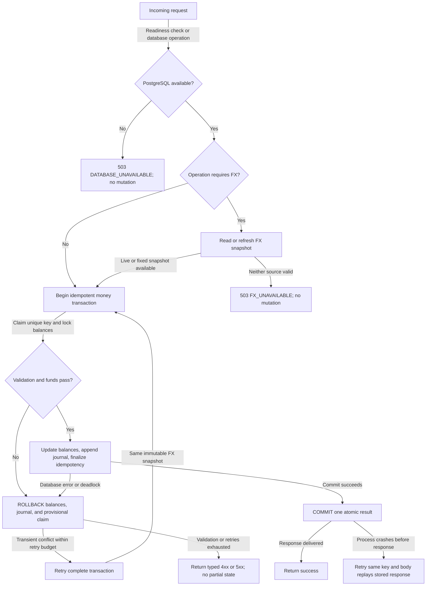

# Harmattan Wallet System Design

This document describes the complete multi-currency wallet sandbox: wallet creation, deposits, swap quotes and execution, transfers, transaction reads, FX refresh, concurrency controls, and failure handling.

## 1. System context and application layers

Domain ownership is explicit:

- `WalletModule` owns wallet lifecycle, deposits, swap quotes/execution, transfers, soft signals, and wallet-relative history through focused application services.
- `TransactionModule` owns the immutable ledger repository and single-transaction lookup. It exports `TransactionRepository` to `WalletModule`.
- The dependency is one-way (`WalletModule` → `TransactionModule`); `DatabaseModule` contains database infrastructure only, so there is no circular module dependency or globally hidden feature repository.

## 2. Deposit, quote, swap, and transfer paths

## 3. FX refresh and single-flight coordination

An incoming provider result is discarded if PostgreSQL already contains an equal or newer provider timestamp. A failed refresh never holds wallet balance locks or a money transaction.

## 4. Data model

`wallet_balances` has a unique `(wallet_id, currency)` constraint. Each wallet is created with cNGN, cGHS, cXAF, USDx, and EURx rows in one transaction. Balances are mutable projections; `transactions` is the immutable audit journal.

## 5. Failure and rollback paths

## 6. Core invariants

- Amounts enter and leave the API as decimal strings; PostgreSQL stores exact `NUMERIC` values.
- A money operation either updates every required balance and appends one journal row, or changes nothing.
- All balance rows are locked in deterministic `(wallet_id, currency)` order.
- Idempotency claims participate in the same database transaction as the money mutation.
- FX refresh advisory locks never overlap wallet row locks.
- The API is stateless; PostgreSQL coordinates correctness across all instances.
- No authentication is required by the assessment. UUIDs are identifiers, not authorization; production needs identity and wallet-ownership checks.
